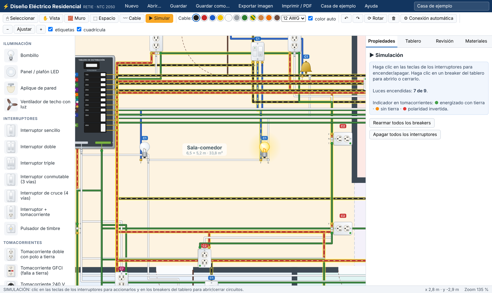
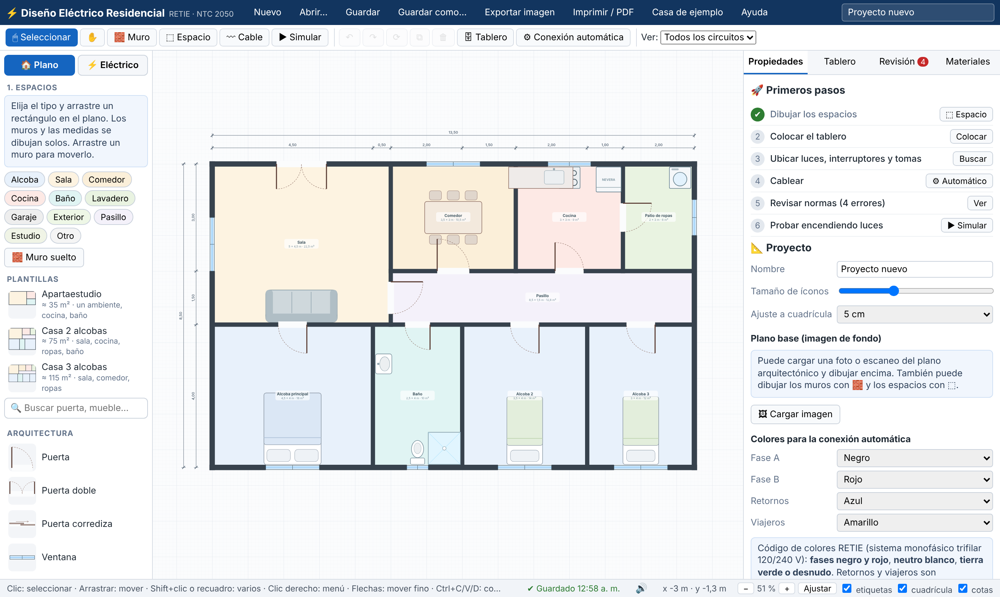
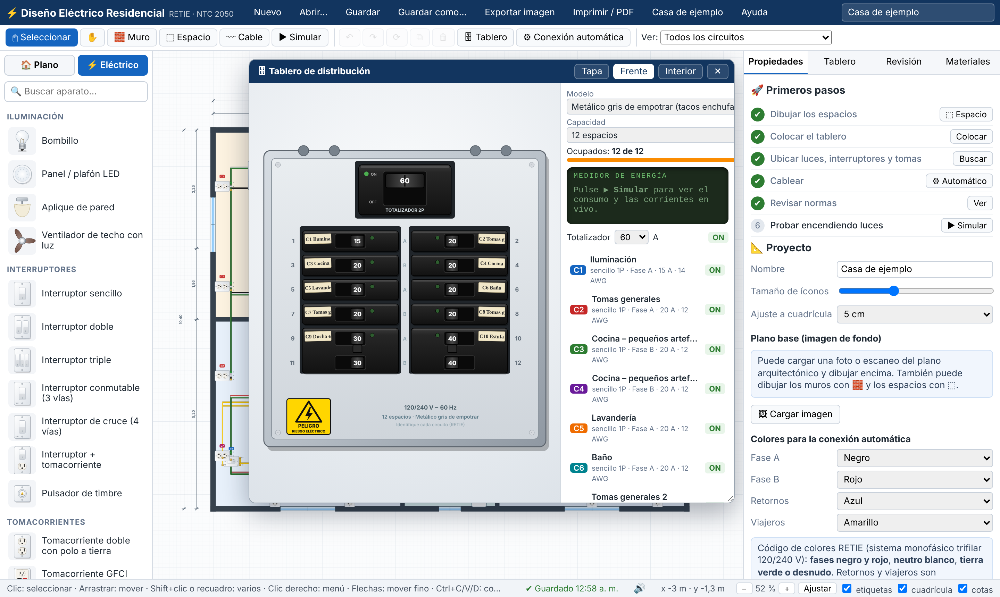
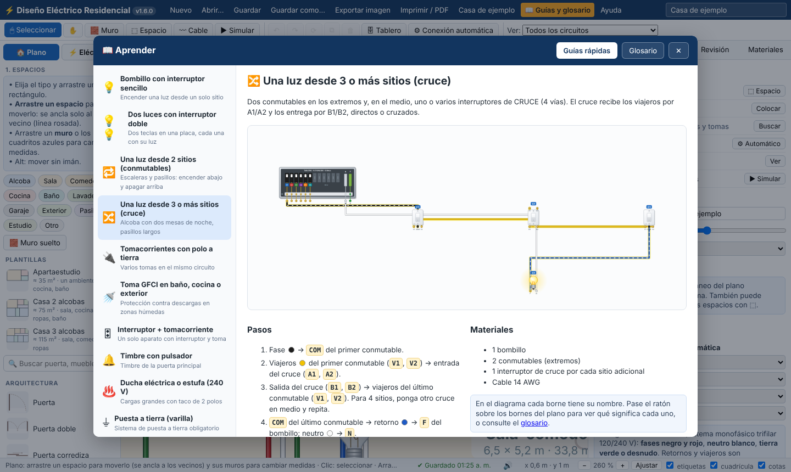
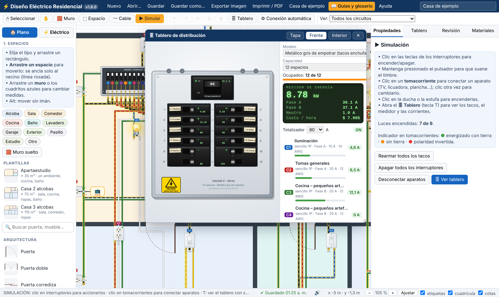
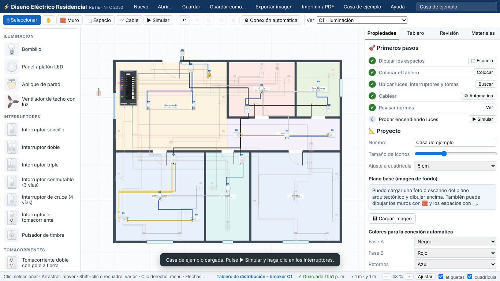

# ⚡ Diseño Eléctrico Residencial (RETIE / NTC 2050)

Programa sencillo para Windows para diseñar la instalación eléctrica de una casa, con aparatos dibujados de forma realista en lugar de símbolos.

## Descargar y usar (Windows 10/11)

1. Descargue la última versión desde **[Releases](https://github.com/soydarwinruiz/diseno-electrico/releases/latest)** (archivo `DisenoElectrico-vX.Y.Z-Windows.zip`) y descomprímalo. Ver el [historial de versiones](CHANGELOG.md).
2. Doble clic en **DisenoElectrico.exe** (se abre en su propia ventana usando Microsoft Edge).
   - Si aparece "Windows protegió su PC": **Más información → Ejecutar de todas formas** (el programa no tiene firma digital).
   - Alternativa: abrir `DisenoElectrico.html` en el navegador.

No requiere internet ni instalación.

## Funciones

### Plano fácil (pestaña 🏠 Plano)
- Elija el tipo de espacio y arrastre un rectángulo: **los muros y las cotas se dibujan solos** (15 cm exteriores, 12 cm interiores).
- **Arrastre un espacio** desde cualquier punto para moverlo: **se ancla solo** al borde del vecino (guía rosada) y lleva consigo sus muebles, puertas, ventanas y aparatos. Alt: mover sin imán.
- **Arrastre un muro** para mover la pared: los espacios vecinos se ajustan y los aparatos pegados al muro lo acompañan.
- Manijas en esquinas y lados para cambiar medidas (también con imán); aviso en rojo si un espacio queda encima de otro.
- Doble clic en un espacio para cambiarle el nombre; al borrarlo se van también sus muebles y aberturas.
- Puertas (sencilla, doble, corrediza) y ventanas que **se insertan en el muro** y abren hacia el lado elegido.
- **Muebles** básicos (camas, sofá, comedor, sanitario, lavamanos, ducha, estufa, nevera, lavadora, mesón).
- **Plantillas**: apartaestudio, casa de 2 alcobas, casa de 3 alcobas.

### Modelos de tablero y de tacos
- Tablero **metálico gris de empotrar**, **blanco de sobreponer** o **modular riel DIN**, en varias capacidades; avisa si no caben los tacos.
- Tacos **sencillos**, **dobles tándem (2 en 1 espacio)**, **bipolares**, **diferenciales** y **bipolares diferenciales**.
- En el plano, todas las salidas del tablero bajan por una **bornera inferior** rotulada (C1, C2… N, T).

### Guías y glosario
- **📖 Guías rápidas** de las instalaciones más comunes (sencillo, doble, 2 sitios, 3 o más sitios, tomas, GFCI, timbre, 240 V, puesta a tierra, derivaciones) con diagrama, pasos y botón para insertarlas en el plano.
- **Glosario** con buscador: COM, S1, viajero, retorno, tándem, AWG…

### Diseño eléctrico

- **Plano base:** muros, espacios (alcoba, sala, cocina, baño, lavadero…), puertas, ventanas e imagen de fondo del plano.
- **Aparatos realistas:** bombillo, plafón LED, aplique, ventilador, interruptor sencillo/doble/triple, conmutable (3 vías), cruce (4 vías), interruptor + tomacorriente, tomacorriente doble, GFCI, 240 V, ducha eléctrica, timbre, empalme, varilla de puesta a tierra.
- **Cables de colores y calibres AWG**, conectados a los bornes de cada aparato (fase, neutro, tierra).
- **Derivaciones**: con la herramienta Cable, un clic sobre un cable existente crea un empalme y desde ahí sale un cable nuevo del mismo color y calibre (cable principal con ramales).
- **Tablero** con breakers configurables (polos, amperaje, calibre, fase, diferencial).
- **Conexión automática:** luces desde 1, 2 o 3+ sitios; tomacorrientes encadenados.
- **▶ Simulación:** accione interruptores y breakers; detecta cortocircuitos.
- **Revisión RETIE / NTC 2050**, cuadro de cargas, balance de fases y lista de materiales (exportable a Excel).
- Guardar/abrir proyectos, exportar imagen, imprimir / PDF.

### Tablero realista e interactivo
- Vista del tablero con **tapa** (señal de riesgo eléctrico RETIE), **frente** con los tacos rotulados y **interior** con barras de cobre, barra de neutro, barra de tierra, puente equipotencial y acometida.
- Clic en un taco para subirlo/bajarlo; un taco disparado muestra **TRIP** y se rearma OFF → ON.
- Arrastre un taco a otra fila: la **fase A/B** cambia según la posición, como en un tablero real.
- **Medidor de energía** en vivo: kW, corriente en fase A, fase B y neutro, costo por hora.
- En simulación: clic en tomacorrientes para **conectar aparatos** (TV, licuadora, plancha…), ducha y estufa encendibles. Si se excede la capacidad, los cables se ponen naranja y el taco **se dispara por sobrecarga**.
- Sonidos de interruptores, tacos y timbre (se pueden silenciar).

### Facilidad de uso
- Interruptores y tomacorrientes **se pegan al muro** y miran hacia el espacio (Alt: ubicación libre).
- **Clic derecho** para menú contextual: rotar, duplicar, asignar circuito, cablear…
- **Ver un solo circuito** (selector *Ver:* o 👁 en la pestaña Tablero).
- **Cablear todo lo que falta** con un clic, espacio por espacio.
- Paleta con **búsqueda** y **arrastrar y soltar**; lista de **primeros pasos**.
- Ctrl+C / Ctrl+V / Ctrl+D, flechas para mover fino, Ctrl+Z / Ctrl+Y.

## Estructura

| Carpeta | Contenido |
|---|---|
| `app/DisenoElectrico.html` | La aplicación completa (HTML + JavaScript, un solo archivo) |
| `launcher/` | Lanzador en Go que incrusta el HTML y lo abre en una ventana de Edge |
| `dist/` | ZIP listo para Windows |
| `build.sh` | Compila `dist/DisenoElectrico.exe` (requiere Go) |

## Aviso

Herramienta de apoyo para diseño y aprendizaje. El diseño definitivo debe ser revisado y firmado por un profesional competente con matrícula, conforme al RETIE y la NTC 2050 vigentes.

## Versiones

El historial está en [CHANGELOG.md](CHANGELOG.md). Para publicar una versión nueva:

1. Cambie `APP_VERSION` en `app/DisenoElectrico.html` (por ejemplo `1.7.0`).
2. Agregue la sección `## v1.7.0 — Título` al inicio de `CHANGELOG.md`.
3. Ejecute `./build.sh`, actualice `dist/DisenoElectrico-Windows.zip` y suba los cambios a `main`.

La acción de GitHub *Publicar versión* (`.github/workflows/publicar-version.yml`) crea sola la etiqueta `v1.7.0` y la **Release** con sus notas y el ZIP para descargar.
